# PodVigil

Independent project; not affiliated with or endorsed by Runpod. Maintained by
[PolaronQuasi](https://github.com/PolaronQuasi).

Run one GPU batch job on a Runpod Secure Cloud Pod from your own computer, with a runtime deadline.
On a successful run you get your results, checked file by file, and a record that shows the Pod and
its storage are gone.

Version **0.1.0**. Start with the [examples](docs/EXAMPLES.md),
[architecture and lifecycle diagrams](docs/diagrams/README.md), or [support guide](SUPPORT.md).

> **Use at your own risk.** You are responsible for cloud charges, your data and backups. To the
> extent permitted by applicable law, the author and contributors accept no liability for losses
> arising from use of this software. Automatic cleanup is not a provider-enforced spending cap. Read
> the [full disclaimer](DISCLAIMER.md) and [Apache-2.0 license](LICENSE).

## What it does

You describe the job in a small JSON file: the container image, the GPU, the command, the input
files, a time limit and a price limit. `podvigil launch <job file>` then:

1. checks the live price, capacity and job limits, and records the job in its local ledger;
2. arms a watchdog: a separate process on your computer that enforces the deadline even if the
   `launch` command dies. It then creates a new network volume and uploads your inputs;
3. creates one Pod. Inside it, a guard process runs your command as an unprivileged user and
   attempts Pod deletion when the job ends or its deadline is reached; provider or network failures
   can delay deletion;
4. downloads the results, checks every file against its SHA-256, deletes the volume, and confirms
   that the Pod and the volume no longer exist.

Every launch, and every command that works on a job, ends with two lines that say what still exists:
first the Pod, then the volume. The result itself, with a named outcome and its exit code, is one
JSON document on standard output; the lines for people go to standard error.

## Who it is for

- **For** people and coding agents who want one unattended batch job on a GPU: "run this for at most
  N hours, give me the files, leave nothing billing", from a Windows or Linux computer.
- **Not for** interactive work (there is no SSH or Jupyter), serving, jobs across several machines,
  or finding the lowest price.
- **Not a spending cap.** The deadline is enforced by this tool, not by Runpod. If Runpod's API is
  unreachable or your computer is off at the wrong moment, a Pod or a volume can keep billing until
  someone deletes it. See [the safety model](docs/SAFETY-MODEL.md).

## Status

- The first real jobs ran on 12 November 2026, launched from Windows: the Pods and volumes were
  deleted and the deletions were verified. That day `launch --detach`, the fallback to a second
  launch candidate, and a `cancel` that let the workload save its outputs each ran once, as
  designed. Long unattended jobs have not been validated yet.
- On Linux the test suite passes, but no real job has been launched from Linux yet.
- One provider (Runpod), Secure Cloud only, one Pod per job.
- Your computer must stay on and online until the job ends.

## Install

You need git and Python 3.10 or newer. CI checks Python 3.10 and 3.12 on Linux, Python 3.13 in Linux
containers, and Python 3.12 on Windows.

Windows (PowerShell):

```powershell
git clone https://github.com/PolaronQuasi/podvigil.git
cd podvigil
python -m venv .venv
.\.venv\Scripts\python.exe -m pip install -r requirements.lock.txt
.\.venv\Scripts\python.exe -m pip install --no-deps .
$env:Path = "$PWD\.venv\Scripts;$env:Path"   # for this terminal session
podvigil --version
```

Linux (bash):

```bash
git clone https://github.com/PolaronQuasi/podvigil.git
cd podvigil
python3 -m venv .venv
.venv/bin/python -m pip install -r requirements.lock.txt
.venv/bin/python -m pip install --no-deps .
source .venv/bin/activate
podvigil --version
```

`podvigil --version` prints `podvigil 0.1.0`. Without installing, `python managed_run.py <command>`
in the checkout runs the same command line.

## Quickstart

The [quickstart](docs/QUICKSTART.md) explains each step. In short:

1. Put your Runpod API key and your Runpod S3 access key and secret into the per-user credentials
   file (`%LOCALAPPDATA%\podvigil\credentials.env` on Windows, `~/.config/podvigil/credentials.env`
   on Linux):

   ```dotenv
   RUNPOD_API_KEY=<your Runpod API key>
   RUNPOD_S3_ACCESS_KEY=<your Runpod S3 access key>
   RUNPOD_S3_SECRET_KEY=<your Runpod S3 secret>
   ```

2. Check the example job offline. This needs no credentials and creates nothing:
   `podvigil plan examples/hello-gpu/job.json`
3. See which GPUs can be placed now, and edit the `candidates` in the job file to match:
   `podvigil survey`
4. Run it. This creates billed resources; the job file plans at most 0.20 USD of compute:
   `podvigil launch examples/hello-gpu/job.json`
5. Read the results in the job's ledger folder, the path printed on the `Job ledger:` line:
   `downloads/artifacts/metrics.json`, `downloads/artifacts/train.log`, and `summary.json`.
   `podvigil status latest`, `podvigil logs latest` and `podvigil cost latest` show the state, the
   logs and the estimated compute cost; `podvigil list` shows all jobs, and `podvigil cancel latest`
   stops a running job early, giving its Pod a bounded time to save the outputs first.

For a detached job, `podvigil wait JOB [--timeout MINUTES]` waits using only its local ledger and
returns the foreground launch's exit code. `JOB` accepts a ledger folder, `latest`, or an ID prefix.
Timeout and Ctrl+C stop the waiting command; the job is unaffected. See [wait](docs/MANUAL.md#wait).

## The two closing lines

A successful run ends like this, on standard error:

```text
Pod <pod id>: deleted; its absence was verified.
Volume <volume id>: deleted; its absence was verified. Nothing from this job remains.
```

When the last line ends with "Nothing from this job remains." (or, for a launch that stopped before
it created anything, "Nothing from this run remains."), nothing is left. Otherwise something may
still exist or bill, and the lines name the command to run, in the form you used (`podvigil`,
`python -m podvigil` or `managed_run.py`). [Troubleshooting](docs/OPERATIONS.md) lists every line
and state the runner can write.

## Read more

- [Quickstart](docs/QUICKSTART.md): the first job, step by step.
- [Concepts](docs/CONCEPTS.md): the ledger, the three guards, the deadline, the evidence.
- [Job file](docs/JOB-FILE.md): every field, launch candidates, folder inputs, limits.
- [Workload contract](docs/WORKLOAD-CONTRACT.md): what your command sees inside the Pod, and what
  the local-disk design costs.
- [Command line](docs/MANUAL.md): every command, option, outcome and exit code.
- [Troubleshooting](docs/OPERATIONS.md): every state and failure message, and what to do.
- [Safety model](docs/SAFETY-MODEL.md): what the runner makes sure of, and what it cannot.
- [Comparison](docs/COMPARISON.md): other ways to run GPU jobs, honestly compared.
- [Development](docs/DEVELOPMENT.md): tests, the paid smoke test, the release checklist.
- [Architecture and lifecycle diagrams](docs/diagrams/README.md).
- [API and workload contract](CONTRACT.md), [compatibility](docs/COMPATIBILITY.md).
- [Security](SECURITY.md), [contributing](CONTRIBUTING.md), [support](SUPPORT.md).
- [Release process](docs/RELEASING.md).



## Licence

Apache License 2.0. See [LICENSE](LICENSE) and [NOTICE](NOTICE).
