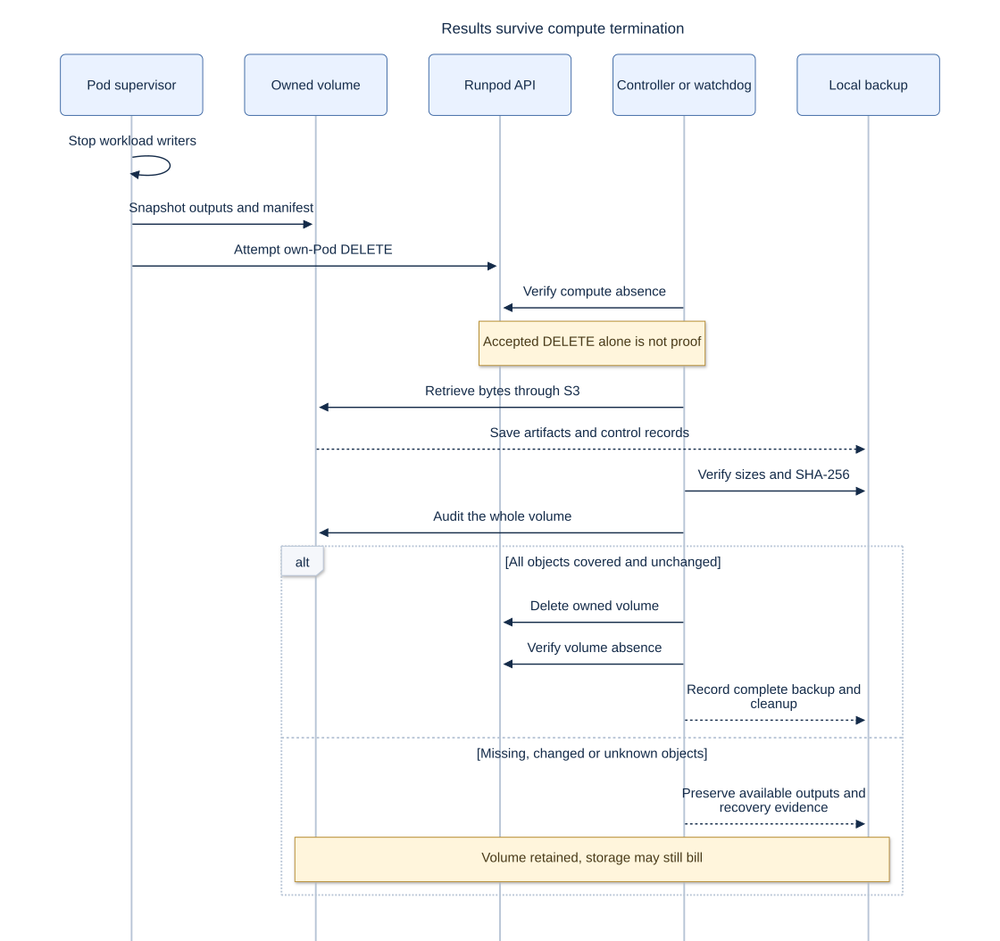

# How PodVigil works

Start with the architecture, then follow a job through finalization, result delivery and recovery.
These diagrams describe the current implementation; they are not a guarantee of live provider
behavior. Read the [manual](../MANUAL.md), [safety model](../SAFETY-MODEL.md) and
[disclaimer](../../DISCLAIMER.md) for the operational boundaries.

<!-- prettier-ignore -->
| Diagram | What it answers | Editable source |
| --- | --- | --- |
| [Architecture](01-architecture.svg) | What runs locally, in the Pod, and at the provider? | [Mermaid](01-architecture.mmd) |
| [Job lifecycle](02-job-lifecycle.svg) | What happens from launch through cleanup? | [Mermaid](02-job-lifecycle.mmd) |
| [Result delivery](03-result-delivery.svg) | When are outputs safe to recover and storage safe to delete? | [Mermaid](03-result-delivery.mmd) |
| [Safe recovery](04-safe-recovery.svg) | What happens after an uncertain or interrupted job? | [Mermaid](04-safe-recovery.mmd) |

## 1. Architecture

Blue boxes execute work, green boxes store data, and purple identifies the provider API. Labels
carry the same meaning without relying on color. The workload writes to Pod-local disk; the
supervisor publishes snapshots to the private network volume. A checkpoint not yet snapshotted can
be lost with the Pod.

## 2. Job lifecycle

Finalization failure must not prevent a compute-deletion attempt. Conversely, compute deletion does
not authorize volume deletion without a complete backup. The configured deadline cannot force a
provider API to respond.

## 3. Result delivery

An accepted DELETE is only a request acknowledgment. Separate read-back and inventory evidence
establish absence. Unknown or changed volume objects retain storage, which may continue to bill.

## 4. Safe recovery

Recovery operates on the existing job and its original deadline. It does not launch another Pod or
sweep unrelated account resources.

## Rebuild the diagrams

Node.js 22 or later is needed only for diagram tooling; PodVigil itself is Python. Run `npm ci` and
`npm run docs:diagrams`. The lockfile pins the renderer and its dependencies. To use an installed
Chrome, set `PUPPETEER_EXECUTABLE_PATH`; for an installation that skips browser downloads, use
`npm ci --ignore-scripts`.

`mermaid.json` defines the diagram palette and typography. Commit both `.mmd` sources and rendered
`.svg` files when changing a diagram.
